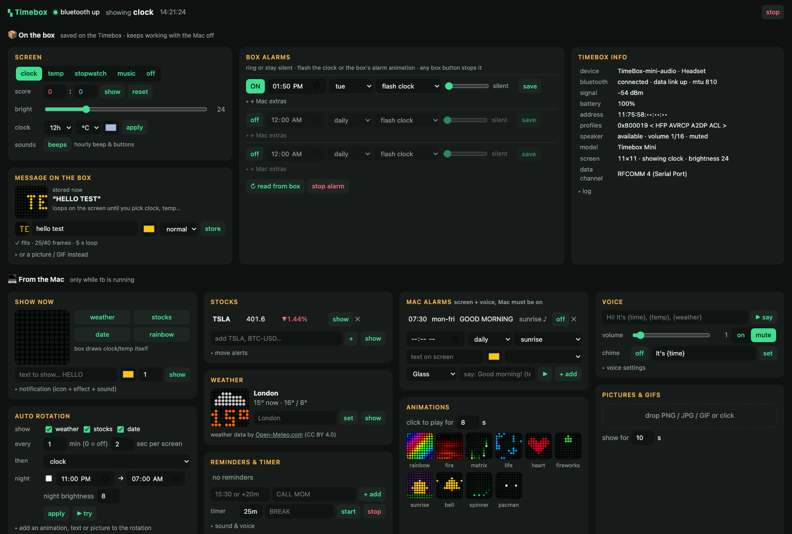
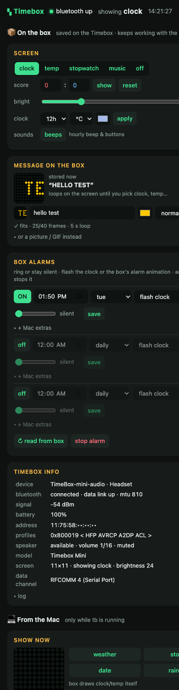

# ▚ div-box

*An unofficial, free controller for Divoom Bluetooth pixel boxes (Timebox Mini first).*

**Give your forgotten Divoom Timebox Mini a second life as a desk sidekick on macOS, Linux, Raspberry Pi or Windows.**
Other Divoom Bluetooth boxes (Pixoo, Pixoo Max, Timebox Evo, Ditoo, Tivoo, Aurabox, Backpack) should work too, untested: see [docs/MODELS.md](docs/MODELS.md).

**100% free and open source (MIT)** · no account · no cloud · no tracking · no app store · nothing to `pip install`.

That little 11×11 LED cube in your drawer can show weather, stock tickers, reminders, GIFs, fireworks and Pac-Man. It can talk, and its own built-in alarms can be set from a friendly dashboard in your browser. Nothing to `pip install`: it's plain Python (standard library) plus a tiny Swift helper that macOS builds for itself.



---

## ✨ What it does

| | |
|---|---|
|  | **Box alarms that work with the computer off.** Read and write the Timebox's own 3 alarm slots: time, weekdays, ring or silent, flashing clock or the box's own alarm animation |
|  | **Messages stored on the box.** Type "BACK AT 3PM" and it lives on the Timebox, looping with the computer off. Short text stands still on two lines, longer text scrolls and is trimmed to whole words so it always fits |
|  | **Weather.** Icon + temperature for any city (Open-Meteo, no API key) |
|  | **Stocks & crypto.** Still screens, 2 s each: ticker, then price over % change (green up, red down), optional "it moved another 1%" tick alerts |
|  | **10 animations.** Fire, fireworks, matrix, rainbow, game of life, heart, sunrise, bell, spinner, pac-man |
|  | **Text, pictures & GIFs.** Any message as still 2-second screens, drop any picture or GIF (auto-shrunk to 11×11), pop notifications from scripts |
| 🗣️ | **It talks.** Alarms, reminders and timers can speak ("Good morning! It's 7:30, 16 degrees and cloudy") through the box's own speaker |
| ⏱️ | **Reminders, Pomodoro timer, hourly chime, night dimming**, plus the box's built-in clock, thermometer screen, stopwatch and music visualizer |

## 🧭 Works where?

| | macOS | Linux / Raspberry Pi | Windows |
|---|---|---|---|
| Screen, text, GIFs, animations, weather, stocks | ✅ | ✅ | ✅ |
| Box alarms, box settings, stored GIF | ✅ | ✅ | ✅ |
| Dashboard, background service | ✅ | ✅ | ✅ |
| Voice & sounds through the box | ✅ best (auto-routes to the box) | ✅ via `espeak-ng`, box = default speaker | ✅ built-in Windows voice, box = default speaker |
| Tested on a real box | ✅ | written, not yet tested | written, not yet tested |

---

## 🚀 Quick start

### 1. Pair the box (all systems)

Turn the Timebox on and pair it like a Bluetooth speaker. It shows up as **TimeBox-mini-audio** (or *TimeBox-mini*). When it says **Connected**, you're ready.

### 2. Install

<details open><summary><b>macOS</b></summary>

You need Python 3 (built in on recent macOS, or `brew install python`) and Apple's command line tools (`xcode-select --install`; you probably have them already).

```bash
git clone https://github.com/<you>/div-box && cd div-box
ln -s "$PWD/bin/tb" /usr/local/bin/tb     # optional: makes `tb` work from anywhere
tb ui
```

The first run builds the tiny **Timebox Bridge** helper, and macOS asks once whether it may use Bluetooth. Say **Allow**. Your browser then opens the dashboard 🎉

</details>

<details><summary><b>Linux / Raspberry Pi</b></summary>

```bash
sudo apt install bluez ffmpeg espeak-ng        # ffmpeg = pictures/GIFs/sounds, espeak-ng = voice (both optional)
bluetoothctl                                   # then: scan on → pair <address> → trust <address> → connect <address>
git clone https://github.com/<you>/div-box && cd div-box
python3 tb.py ui
```

The box's address is found automatically from `bluetoothctl devices`. If not, save it once with `python3 tb.py address 11:75:58:XX:XX:XX`. For voice, pick the Timebox as your default speaker (Settings → Sound, or `pactl set-default-sink`).

</details>

<details><summary><b>Windows</b></summary>

Install [Python 3.9+](https://www.python.org/downloads/) and, for pictures and GIFs, [ffmpeg](https://www.gyan.dev/ffmpeg/builds/) (add it to PATH). Pair the box in *Settings → Bluetooth & devices*.

```powershell
git clone https://github.com/<you>/div-box
cd div-box
python tb.py ui
```

If the address isn't detected: *Device Manager → the Timebox → Properties → Details → Bluetooth device address*, then `python tb.py address 11:75:58:XX:XX:XX`. For voice, set the Timebox as the default speaker.

</details>

> Everywhere: `tb …` on macOS equals `python3 tb.py …` (or `python -m timebox …`) on Linux and Windows.

---

## 🖥️ The dashboard

`tb ui` starts the background service (if needed) and opens **http://127.0.0.1:8411** in your browser.

- **📦 On the box** (top row): saved **on the Timebox itself**, keeps working with the computer off: screen mode, brightness, 12/24 h, °C/°F, clock color, the box's own beeps, a stored message or GIF, and the 3 box alarms (silent or 1-16 loud, flashing clock or the box's alarm animation). Plus a Timebox info card: signal, battery, model.
- **💻 From the computer** (everything below): needs the service running: show weather/stocks/text now, auto rotation, night dimming, stocks, reminders, timer, talking alarms, animations, pictures, voice.

### What keeps working with the computer off?

| ✅ Saved on the box | ❌ Needs the computer |
|---|---|
| Clock (12/24 h, color), brightness, screen mode | Live weather, stocks, notifications |
| 3 alarms: time, days, silent or loud, flash or alarm animation | Talking, sounds, reminders, timers |
| One stored message or GIF (up to 40 frames), looping | Showing custom text/pictures *at* alarm time |

It works on a phone-sized window too:



## 🕹️ The `tb` command

```bash
tb text "HELLO WORLD" --color cyan        # still screens, 2 s each (about 3 letters per line)
tb anim fireworks --secs 10
tb weather | tb stock NVDA BTC-USD
tb image ~/Pictures/cat.gif               # any picture or GIF
tb upload ~/Pictures/nyan.gif             # store it ON the box (loops without the computer)
tb boxtext "back at 3pm" --color yellow   # or store a message ON the box instead (--speed slow|normal|fast)
tb score 3 1                              # the box's own scoreboard, red : blue (stays until you change screen)
tb say "Hello from your desk"             # talks through the box
tb sound chime                            # tb sounds lists them all
tb notify "NEW MAIL" --icon mail --anim spinner --sound
tb clock --12 --color orange | tb temp | tb off
tb bright 40 | tb volume 6 | tb beeps off
tb model                                  # which Divoom box (auto-detected; tb model pixoo to override)
```

**Box alarms** (stored on the Timebox, ring with the computer off):

```bash
tb boxalarm set 1 07:30 --days mon-fri --volume 2      # volume 0-16 like the box
tb boxalarm set 2 08:00 --days weekend --gif --silent  # built-in alarm animation, no sound
tb boxalarm list | tb boxalarm off 1
```

**Just type `tb`.** It starts the service if needed and prints a short status, the dashboard link and the main commands. **`tb exit`** switches everything off again (service + Bluetooth link). Want it at login? Point your own launcher (e.g. a login item or Keyboard Maestro "Execute Shell Script") at the full path of `tb`.

**The service** runs only when you start it (no login items, no surprises):

```bash
tb start --show weather,stocks,date --every 10 --stocks NVDA,AAPL --city Paris
tb set --base clock --clock-color cyan --h12 --quiet 23:00-07:00@8
tb set --page 3                           # each screen stays up 3 s (default 2)
tb remind 15:30 "CALL MOM" --speak "Time to call mom"     # or +20m, or "2026-12-24 18:00"
tb alarm add 07:30 --days mon-fri --anim sunrise --speak "Good morning! It's {time}, {temp} and {weather}"
tb timer 25m "BREAK" --speak "Break time, stretch your legs"
tb alerts on --step 1 --every 5 --speak                   # stock moved another 1%? tick + voice
tb chime on --speak "It's {time}"                         # hourly
tb status | tb stop
```

Spoken text understands `{time} {date} {day} {temp} {weather} {hi} {lo} {city}`. Run `tb -h` or `tb <command> -h` for every option.

## 🧪 Testers wanted

Got a **Pixoo, Pixoo Max, Timebox Evo, Ditoo, Tivoo, Aurabox or Divoom Backpack**? The code for them is written
([docs/MODELS.md](docs/MODELS.md)) but nobody has tried it on real hardware yet. Ten minutes of your time helps a lot:

```bash
tb model                 # did it detect your box?
tb text "HELLO"          # does text show?
tb weather | tb clock    # weather, then the clock
tb boxtext "HI"          # stored on the box?
```

Then [open an issue](../../issues/new?template=device-report.md) with your model and what worked. A photo of the screen is gold.
On a Timebox Mini with something odd? Same thing, issues are welcome.

## 🛠️ Hack on it

Plain Python 3 standard library, one small Swift helper on macOS, no build step. Start with
[CONTRIBUTING.md](CONTRIBUTING.md); it's short. Good first ideas: a new animation in `timebox/effects.py`, a new
icon in `timebox/gfx.py`, a translation of the dashboard, or a tested profile for another Divoom box.

## 🎤 About the microphone

The Mini is a Bluetooth **speakerphone**: its mic streams live to the computer at phone-call quality (8 kHz mono). It can't record onto the box. On macOS, `mic/record.sh 5` saves a WAV from the box's mic.

## 🔌 Reconnects by itself

Switch the box off and on, or toggle Bluetooth: the link comes back on its own within seconds. While the box is away, frames are dropped, so nothing hangs.

## 🩹 Troubleshooting

| Problem | Fix |
|---|---|
| Box frozen (screen stuck, button dead) | Press the **reset pinhole** with a paperclip. Pairing usually survives |
| `tb status` says *box offline* | Is it on and **Connected** in Bluetooth settings? Run any `tb` command to reconnect |
| First spoken word cut off | Raise **wake** in the dashboard's Voice & Audio panel (the box mutes itself on silence) |
| Box alarm won't stop | Press **stop alarm** on the dashboard, or any button on the box |
| Hourly beep | `tb beeps off` silences the box's own sounds; our voice keeps working |
| macOS: "Timebox Bridge would like to use Bluetooth" | Allow it, it's the helper this project builds |

## ⚠️ Commands that freeze the box

Some commands lock up the Mini's firmware until you press the reset pinhole. This tool never sends them:
- `0x61` set FM frequency (even correctly formatted)
- guessing at undocumented opcodes

Extending the protocol? Start from [docs/PROTOCOL.md](docs/PROTOCOL.md) and the community projects below; don't guess.

## 🔒 Safe by design

- **No third-party Python packages.** Optional helpers are well-known tools (ffmpeg, espeak-ng).
- The macOS helper is ~150 lines of Swift ([bridge/tbridge.swift](bridge/tbridge.swift)) that you build yourself; it only talks to the Timebox.
- The dashboard listens on `127.0.0.1` only, needs a random per-install key and rejects foreign `Host` headers.
- The only internet calls are weather ([Open-Meteo](https://open-meteo.com/), CC BY 4.0) and quotes (Yahoo/Stooq, unofficial, personal use). Never Divoom's servers.

## 🧠 How it works

```
tb / dashboard (Python) ──▶ macOS: Timebox Bridge.app (IOBluetooth) ─┐
                         └▶ Linux/Windows: Python Bluetooth socket ───┴─▶ RFCOMM ch 4 ─▶ 📦 Timebox
```

Fun fact: macOS creates a `/dev/cu.TimeBox-mini-audio` serial port for the box, but writes to it are silently swallowed. So on macOS a tiny app opens the Bluetooth channel itself; Linux and Windows talk to it straight from Python.

| Where | What |
|---|---|
| `timebox/proto.py` | message framing, commands, box alarm records |
| `timebox/device.py` | the Bluetooth link (bridge on macOS, socket elsewhere) |
| `timebox/gfx.py`, `effects.py` | 11×11 canvas, pixel font, icons, animations |
| `timebox/sound.py` | voice + sounds per OS |
| `timebox/app.py`, `web.py`, `ui.html` | service, scheduler, dashboard |
| `docs/PROTOCOL.md` | everything known about the wire protocol, incl. what we verified |

Settings live in `~/.config/timebox/` (config, logs, uploaded media).

## 🙏 Thanks

The protocol was pieced together from earlier projects. Huge thanks to their authors:
[jbfuzier/timeboxmini](https://github.com/jbfuzier/timeboxmini) ·
[Smanar/timebox](https://github.com/Smanar/timebox) ·
[mathoudebine/homeassistant-timebox-mini](https://github.com/mathoudebine/homeassistant-timebox-mini) ·
[derHeinz/divoom-adapter](https://github.com/derHeinz/divoom-adapter) ·
[RomRider/node-divoom-timebox-evo](https://github.com/RomRider/node-divoom-timebox-evo) ·
[d03n3rfr1tz3/hass-divoom](https://github.com/d03n3rfr1tz3/hass-divoom).
No code was copied; this is a fresh implementation (details and credits in [NOTICE.md](NOTICE.md)).

## ⚖️ Legal bits

- **Unofficial.** Not made, approved or supported by Divoom. Divoom, Timebox, Pixoo, Ditoo and friends are Divoom's trademarks, used here only to say what this works with.
- **Nothing of Divoom's inside.** No app, firmware, logos, photos or icons; all pixel art here is our own. It only talks to the box you own, over Bluetooth.
- **Use at your own risk.** A bad command can freeze a box until reset. MIT license, no warranty.
- **Data.** Weather by [Open-Meteo.com](https://open-meteo.com/) (CC BY 4.0). Stock quotes come from public pages for personal use.

MIT licensed: use it, change it, share it, free forever. Have fun. 🎆
