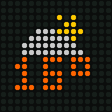
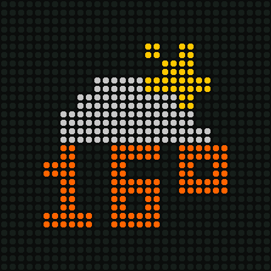

# Other Divoom boxes

Only the **Timebox Mini** has been tested on real hardware. Everything else here is built from the per-device
code in [hass-divoom](https://github.com/d03n3rfr1tz3/hass-divoom) (plus RomRider's Evo notes and the Ditoo Pro
opcode table). It should work, but it hasn't been tried. If you have one of these, please open an issue and
tell us what worked.

| Model | `tb model` | Screen | Picked automatically from Bluetooth name |
|---|---|---|---|
| Timebox Mini | `timeboxmini` | 11×11 | `…mini…` ✅ tested |
| Aurabox | `aurabox` | 10×10, 8 colours | `…aura…` |
| Timebox Evo | `timebox` | 16×16 | `…evo…` / other `timebox` |
| Pixoo | `pixoo` | 16×16 | `…pixoo…` |
| Pixoo Max | `pixoomax` | 32×32 | `…max…` |
| Ditoo / Ditoo Pro | `ditoo` | 16×16 | `…ditoo…` |
| Tivoo | `tivoo` | 16×16 | `…tivoo…` |
| Backpack | `backpack` | 16×16 | `…backpack…` |

```bash
tb model            # what we think you have
tb model pixoo      # override
tb model auto       # detect again from the Bluetooth name
```

## How it adapts

Everything (clock text, weather, stocks, animations, stored messages) is drawn at 11×11, then fitted to the screen.
On 16×16 it's centred with a small border. On 32×32 it's doubled and centred. On the Aurabox it's cropped to 10×10.

| Mini 11×11 | Aurabox 10×10 | Pixoo / Evo / Ditoo 16×16 | Pixoo Max 32×32 |
|---|---|---|---|
|  |  |  |  |

## What differs per family

| | Mini | Aurabox | Pixoo generation (Evo, Pixoo, Max, Ditoo, Tivoo, Backpack) |
|---|---|---|---|
| Byte escaping | yes | yes | no |
| Image | 12-bit raw pixels | 3-bit colours, 2 px per byte | palette + bit-packed indices (`AA LEN …`) |
| Stored animation | one message per frame | same | frames concatenated, sent in 200-byte chunks |
| Clock | `45 00 h24 RGB` | `45 00 h24 RGB` | `2D h24` + `45 00 h24 style …` |
| Off | `45 02` | `45 02` | light channel, power 0 |
| Weather | – | – | `5F temp code`: the box keeps its own weather screen; sent whenever weather is shown |
| Box alarms | 3 slots, bit0 = Monday (verified) | simple on/off | bit0 = Sunday (converted for you), untested |
| Stopwatch | yes | – | – (skipped) |
| Volume | 0-16 | 0-16 | 0-15; none on Pixoo / Max / Backpack |

The RFCOMM channel comes from the box's Serial Port service record, so it adapts automatically. That matters
for newer Pixoo units, which no longer use channel 1.

**Known risks** (from hass-divoom issues): a Pixoo Max froze on badly formatted 32×32 frames (handled here with
the marker frames and palette flag 03). Never send `0x61` (FM frequency): it froze our Mini.
